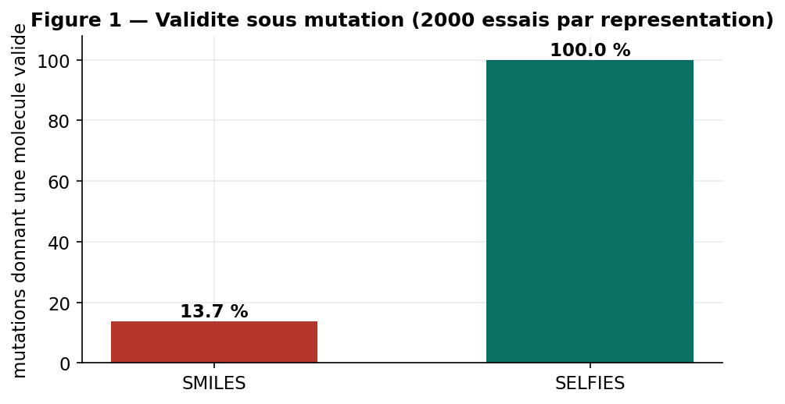
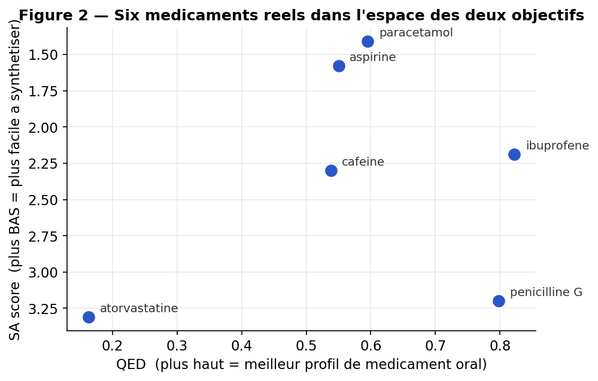
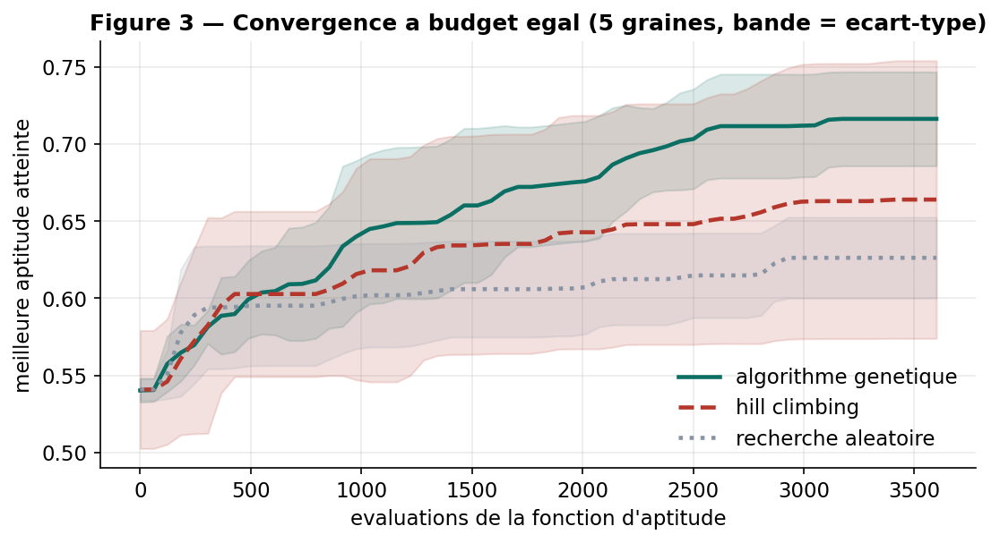
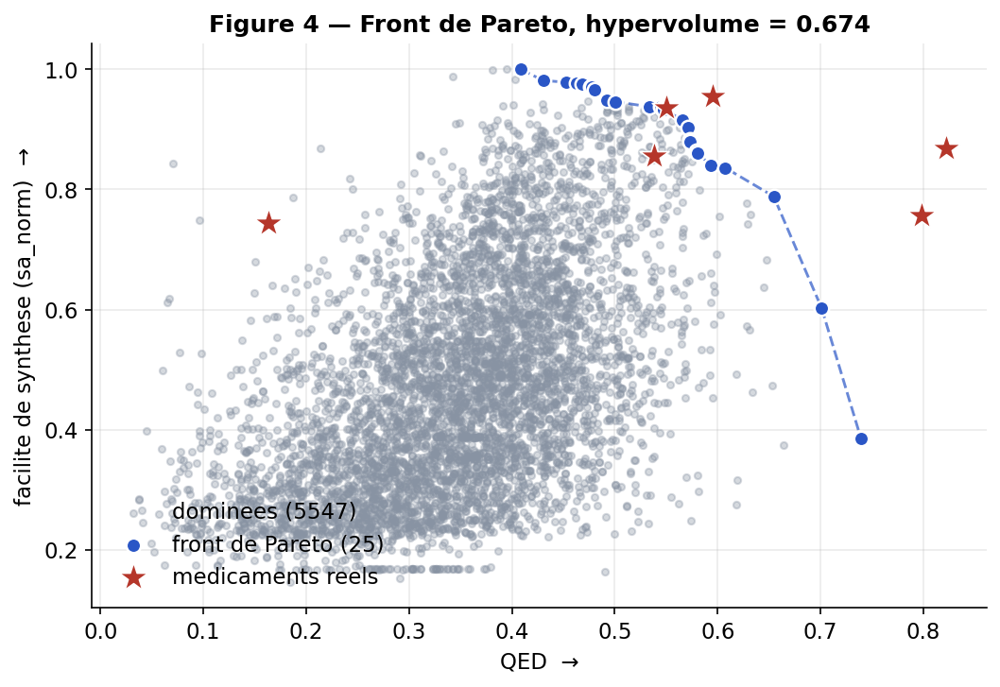
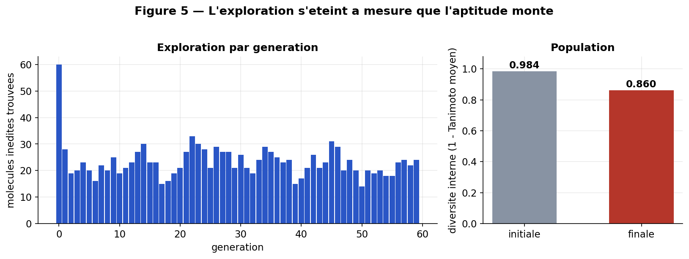
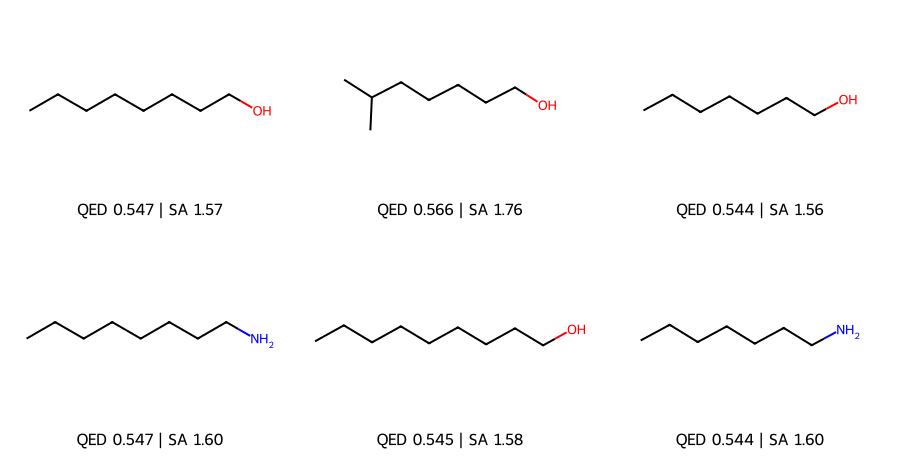
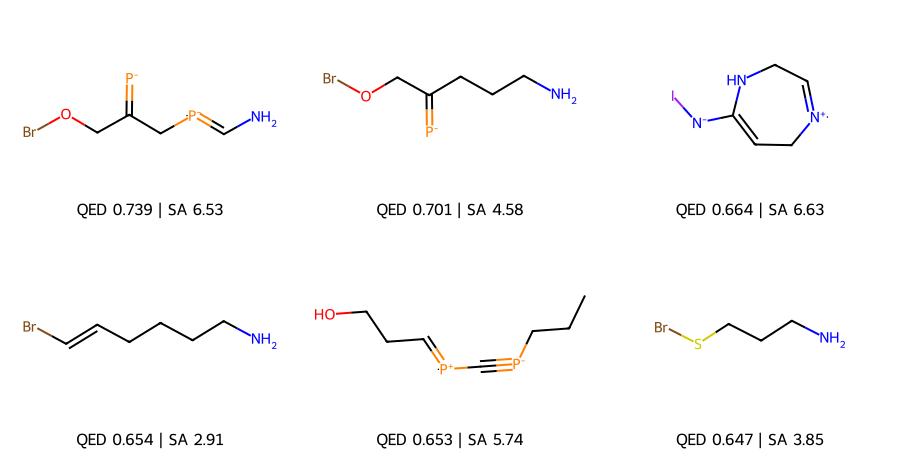

# C3 — Résultats mesurés

> Généré par `notebooks/analise.ipynb`. **Ne pas modifier à la main** : réexécuter le notebook régénère ce fichier.

- **Exécuté le** 2026-11-23 20:01 UTC
- **Versions** Python 3.13.18, RDKit 2026.09.2, selfies 2.1.1
- **Paramètres** 5 graines, population 60, 60 générations, poids QED 0.5
- **Budget** 3600 évaluations par méthode et par graine

## 1. Validité sous mutation

Sur 2000 altérations d'une unité appliquées à chaque représentation :

| Représentation | Molécules valides |
|---|---|
| SMILES | 13.7 % |
| SELFIES | 100.0 % |

Facteur : **×7.3**. C'est la justification du choix de représentation.

Exemples de SMILES cassés par une seule substitution :

```
CC(=O)Oc1ccccc1C(=O)O  ->  CC(=O)Oc1cccc-1C(=O)O
CC(C)Cc1ccc(cc1)C(C)C(=O)O  ->  CC(C))c1ccc(cc1)C(C)C(=O)O
Cn1cnc2c1c(=O)n(C)c(=O)n2C  ->  Cn1cnc2c2c(=O)n(C)c(=O)n2C
CC1(C)SC2C(NC(=O)Cc3ccccc3)C(=O)N2C1C(=O)O  ->  CC1(C)SC2C(NC(=O)Cc3ccccc3)C(=O)N2C1C(=2)O
```



## 2. Échelle réelle des deux notes

QED et SA mesurés sur six médicaments réels. C'est la référence qui permet de juger si une molécule générée a une note plausible.

| Molécule | QED | SA | sa_norm |
|---|---|---|---|
| ibuprofene | 0.822 | 2.19 | 0.868 |
| penicilline G | 0.798 | 3.2 | 0.756 |
| paracetamol | 0.595 | 1.41 | 0.955 |
| aspirine | 0.55 | 1.58 | 0.936 |
| cafeine | 0.538 | 2.3 | 0.856 |
| atorvastatine | 0.163 | 3.31 | 0.744 |



## 3. Résultat principal : GA contre les lignes de base

Budget identique de 3600 évaluations, 5 graines.

| Méthode | Moyenne | Écart-type | Max | Molécules distinctes |
|---|---|---|---|---|
| algorithme genetique | 0.7163 | 0.0305 | 0.7417 | 5572 |
| hill climbing | 0.664 | 0.09 | 0.7514 | 4977 |
| recherche aleatoire | 0.6262 | 0.0263 | 0.6656 | 12908 |

Écart GA − aléatoire : **+0.0901**, pour un écart-type de 0.0263 sur la ligne de base.
**À interpréter :** si cet écart ne dépasse pas l'écart-type, l'algorithme génétique n'évolue rien et il faut chercher un bug.



## 4. Multiobjectif : front de Pareto

- Molécules distinctes évaluées par le GA : **5572**
- Taille du front de Pareto : **25**
- Hypervolume (référence 0,0) : **0.674**

Dix premières molécules du front, par QED décroissant :

| QED | SA | SMILES |
|---|---|---|
| 0.7392 | 6.529 | NC=[P-]CC(=[P-])COBr |
| 0.7011 | 4.581 | NCCCC(=[P-])COBr |
| 0.6545 | 2.905 | NCCCCC=CBr |
| 0.6073 | 2.475 | CCCCC(C)CCCN |
| 0.5935 | 2.442 | CCCCC(C)CO |
| 0.5805 | 2.258 | CCCCSCCCO |
| 0.5796 | 2.23 | CCCCCSCCCN |
| 0.5735 | 2.093 | N#CCCCCCCCO |
| 0.5728 | 2.058 | N#CCCCCCCCCO |
| 0.571 | 1.874 | CC(C)CCCO |



## 5. Diversité

| Population | Diversité interne | Squelettes |
|---|---|---|
| initiale | 0.9836 | 2 |
| finale | 0.8604 | 0 |

Archive conservée : **1400** molécules distinctes. C'est elle qui sauve le résultat quand la population finit en clones.



## 6. Les molécules, et la loi de Goodhart

### Meilleures selon l'aptitude combinée

| Aptitude | QED | SA | SMILES |
|---|---|---|---|
| 0.7417 | 0.547 | 1.573 | CCCCCCCCO |
| 0.7408 | 0.5655 | 1.756 | CC(C)CCCCCO |
| 0.7407 | 0.5442 | 1.565 | CCCCCCCO |
| 0.7402 | 0.5471 | 1.601 | CCCCCCCCN |
| 0.7398 | 0.5446 | 1.585 | CCCCCCCCCO |
| 0.7389 | 0.5441 | 1.596 | CCCCCCCN |



### Meilleures selon le QED seul

À examiner d'un œil critique : aucun des six médicaments approuvés de la section 2 n'atteint ces valeurs.

| QED | SA | Aptitude | SMILES |
|---|---|---|---|
| 0.7392 | 6.529 | 0.5624 | NC=[P-]CC(=[P-])COBr |
| 0.7011 | 4.581 | 0.6516 | NCCCC(=[P-])COBr |
| 0.6637 | 6.625 | 0.5194 | I[N-]C1=CC[N+]=CCN1 |
| 0.6545 | 2.905 | 0.7214 | NCCCCC=CBr |
| 0.6527 | 5.738 | 0.5631 | CCC[P-]#C[P+]=CCCO |
| 0.6472 | 3.852 | 0.6651 | NCCCSBr |



QED maximal généré : **0.7392**. QED maximal parmi les six médicaments réels : **0.822**.
### Le test le plus severe : le front atteint-il les medicaments reels ?

| Médicament | Domine du front | Dominé par le front |
|---|---|---|
| ibuprofene | 7 | 0 |
| penicilline G | 2 | 0 |
| paracetamol | 13 | 0 |
| aspirine | 1 | 0 |
| cafeine | 0 | 9 |
| atorvastatine | 0 | 23 |

**4 médicament(s) qu'aucune molécule du front ne domine : ibuprofene, penicilline G, paracetamol, aspirine.** Chacun est un compromis QED/synthèse que la recherche n'a pas su égaler.

## 7. Vérification indépendante

- Molécules vérifiées : **5572**
- Problèmes dans le registre : **0**
- Problèmes dans le front : **0**
- Falsification volontaire détectée : **oui**

Le vérificateur recalcule chaque note par un chemin de code propre, sans réutiliser le cache ni les fonctions de la recherche.

---

Données brutes complètes, courbes incluses : `mesures.json`.

## Conclusions

**1. La representation.** La validite passe de **13.7 %** (SMILES) a **100.0 %** (SELFIES) sous la meme perturbation d'une unite, sur 2000 essais : un facteur **x7.3**. C'est ce qui rend le croisement et la mutation utilisables sans aucun rejet. Ce n'est pas une performance de l'algorithme mais une propriete de la grammaire.

**2. La recherche.** A budget egal de **3600 evaluations** et sur **5 graines**, le GA atteint **0.7163 ± 0.0305**, contre 0.6262 ± 0.0263 pour la recherche aleatoire et 0.6640 ± 0.0900 pour le hill climbing. L'ecart au plancher est de **+0.0901**, soit environ **3.4 ecarts-types** de la ligne de base : le gain est reel. Deux nuances : le hill climbing atteint un maximum superieur (0.7514 contre 0.7417) avec 3 fois l'ecart-type du GA -- il est instable, pas meilleur ; et la recherche aleatoire trouve 2.3 fois plus de molecules distinctes -- elle explore plus, elle ne sait pas ou aller.

**3. Le multiobjectif.** Le front compte **25 molecules distinctes**, pour un hypervolume de **0.674** sur 5572 molecules evaluees. Mais le test severe est ailleurs : **4 des 6 medicaments reels ne sont domines par aucune molecule du front** (ibuprofene, penicilline G, paracetamol, aspirine). Autrement dit, la recherche n'a rien produit qui soit a la fois plus proche d'un medicament oral et plus facile a synthetiser que ceux-la.

**4. La diversite.** Elle passe de **0.9836** a **0.8604** entre la population initiale et la finale, et l'archive conserve **1400 molecules distinctes**. Les molecules inedites par generation restent quasi constantes (21.2 sur les dix premieres generations, 20.2 sur les dix dernieres) : **l'effondrement attendu n'a pas eu lieu** a cette echelle. Le nombre de squelettes final est 0, ce qui n'est pas une anomalie : les championnes sont acycliques, et une molecule sans cycle n'a pas de squelette de Bemis-Murcko.

**5. Les limites.** Optimise sur les deux objectifs, l'algorithme converge vers `CCCCCCCCO` (QED 0.547, SA 1.573) : un alcool gras, c'est-a-dire un solvant, pas un medicament. Sur le QED seul, il produit `NC=[P-]CC(=[P-])COBr` (QED 0.7392, SA 6.529), structure valide selon la grammaire mais irrealisable. Le QED maximal genere (0.7392) reste en dessous du meilleur medicament reel (0.822) : la metrique n'a pas explose, l'optimiseur a simplement trouve la zone ou elle est peu exigeante. C'est la loi de Goodhart sous sa forme la plus discrete.

**Ce que nous ne pretendons pas avoir fait.** Ce travail propose des structures bien notees par deux formules statistiques. Il ne decouvre pas de medicaments. Le QED mesure une ressemblance de profil physique avec les medicaments oraux connus ; le SA mesure la frequence de fragments dans des bases de composes, sans simuler aucune reaction. Une campagne reelle s'appuierait sur la simulation d'amarrage sur une cible, des modeles d'ADME et de toxicite, et le jugement de chimistes medicinaux.
